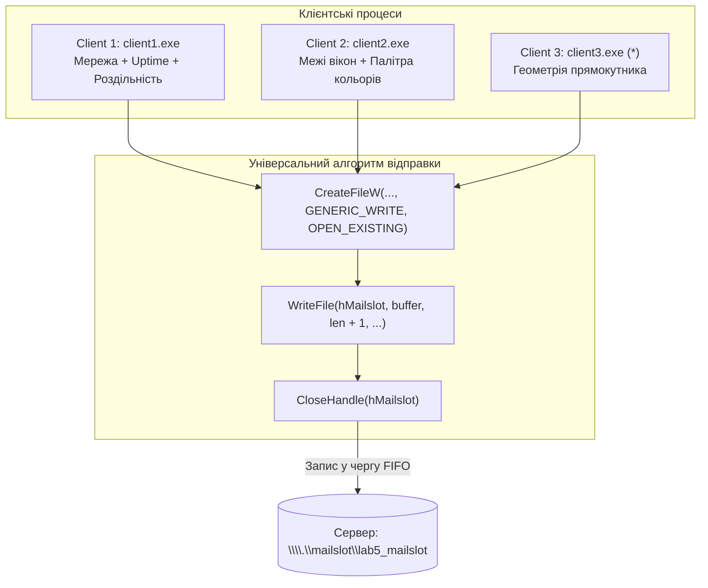

# Пояснення коду клієнтів (`client1.cpp`, `client2.cpp`, `client3.cpp`)
## Лабораторна робота №5: Клієнт-серверна архітектура з використанням Mailslot (Варіант 9 + Завдання із зірочкою `*`)

---

## 1. Загальний огляд клієнтських програм

Усі три клієнти розроблені як нативні віконні додатки **Win32 GUI** (без консолі) і виконують спільне завдання: **збір/обчислення специфічних даних та їх одностороння передача на сервер через чергу повідомлень Mailslot** (`\\.\mailslot\lab5_mailslot`).

Оскільки архітектура клієнтів є уніфікованою, вони мають майже ідентичний життєвий цикл і функцію відправки даних, проте відрізняються **призначенням та набором даних**:

### Зведена таблиця відмінностей клієнтів

| Характеристика | Клієнт 1 (`client1.cpp`) | Клієнт 2 (`client2.cpp`) | Клієнт 3 (`client3.cpp`) — Зірочка `*` |
| :--- | :--- | :--- | :--- |
| **Тематика даних** | Мережа, час роботи ОС, розмір екрана | 3D-рамки елементів, глибина кольору | Інтерактивний розрахунок прямокутника |
| **Системні виклики** | `GetSystemMetrics`, `GetTickCount64`, `GetDeviceCaps` | `GetSystemMetrics`, `GetDeviceCaps` | Математичні функції `sqrt()`, `atof()` |
| **Ключові параметри** | `SM_NETWORK`, `SM_CXSCREEN`, `HORZRES` | `SM_CXEDGE`, `SM_CYEDGE`, `NUMCOLORS`, `BITSPIXEL` | Сторони $a$ та $b$, $S$, $P$, $d$, радіус $R$ |
| **Користувацький ввід** | Автоматичний збір (кнопка Refresh) | Автоматичний збір (кнопка Refresh) | Ручний ввід параметрів (текстові поля + кнопки) |
| **Позиція вікна $(x, y, w, h)$** | `(530, 30, 480, 270)` — зверху праворуч | `(530, 320, 480, 270)` — по центру праворуч | `(530, 610, 480, 360)` — знизу праворуч |



---

## 2. Спільна архітектура та механізм надсилання у Mailslot

### 2.1. Чому для клієнта використовується `CreateFileW`, а не `CreateMailslotW`?
* **Сервер** є *власником* поштової скриньки, тому він її **створює** через `CreateMailslotW`.
* **Клієнт** розглядає Mailslot як звичайний файл особливого типу (псевдофайл ядра Windows). Тому клієнт **відкриває існуючий канал на запис** через стандартну системну функцію `CreateFileW`.

### 2.2. Детальний аналіз функції `SendMailslotData`
Ця функція є ключовою в усіх трьох клієнтах:

```cpp
void SendMailslotData(HWND hWnd)
{
    // 1. Перевірка наявності тексту в полі перегляду
    int textLen = GetWindowTextLengthA(hwndEdit);
    if (textLen <= 0)
    {
        MessageBoxW(hWnd, L"Text field is empty...", L"Warning", MB_OK | MB_ICONWARNING);
        return;
    }

    // 2. Виділення динамічної пам'яті під буфер (+2 байти для null-термінатора)
    char* buffer = (char*)malloc(textLen + 2);
    if (!buffer) return;

    GetWindowTextA(hwndEdit, buffer, textLen + 1);

    // 3. Відкриття поштової скриньки сервера
    HANDLE hMailslot = CreateFileW(
        MailslotName,             // L"\\\\.\\mailslot\\lab5_mailslot"
        GENERIC_WRITE,            // Лише право на запис! (Клієнт не може читати мейлслот)
        FILE_SHARE_READ,          // Дозволити серверу читати файл паралельно
        nullptr,                  // Захист за замовчуванням
        OPEN_EXISTING,            // Обов'язково: відкрити тільки якщо сервер уже створив скриньку!
        FILE_ATTRIBUTE_NORMAL,    // Звичайний псевдофайл
        nullptr                   // Шаблон відсутній
    );

    // 4. Обробка помилки (наприклад, якщо сервер ще не запущений)
    if (hMailslot == INVALID_HANDLE_VALUE)
    {
        DWORD err = GetLastError(); // Код 2 = ERROR_FILE_NOT_FOUND (сервер вимкнено)
        wchar_t errMsg[256];
        swprintf_s(errMsg, L"Mailslot server error: %lu\r\n(Make sure the server is running!)", err);
        MessageBoxW(hWnd, errMsg, L"Send Error", MB_OK | MB_ICONERROR);
        free(buffer);
        return;
    }

    // 5. Запис даних у поштову скриньку
    DWORD cbWritten = 0;
    BOOL bSuccess = WriteFile(
        hMailslot,
        buffer,
        (DWORD)strlen(buffer) + 1, // Передаємо рядок РАЗОМ із термінальним нулем '\0'
        &cbWritten,
        nullptr
    );

    // 6. Закриття дескриптора та звільнення оперативної пам'яті
    CloseHandle(hMailslot);
    free(buffer);

    // 7. Сповіщення користувача
    if (bSuccess)
        MessageBoxW(hWnd, L"Data sent successfully!", ..., MB_OK | MB_ICONINFORMATION);
    else
        MessageBoxW(hWnd, L"Failed to write to mailslot.", ..., MB_OK | MB_ICONERROR);
}
```

> [!IMPORTANT]
> **Чому `CloseHandle` викликається одразу після запису?**  
> Mailslot є протоколом **без встановлення постійного з'єднання (connectionless/datagram-based)**. Клієнт відкриває дескриптор, "вкидає" пакет у чергу, негайно закриває дескриптор і звільняє пам'ять. Це дозволяє тисячам клієнтів писати в одну скриньку без вичерпання лімітів відкритих дескрипторів ОС.

---

### 2.3. Загальний цикл обробки повідомлень Win32
Усі клієнти мають класичну структуру Windows-програми:
1. `wWinMain`: реєструє віконний клас (`MyRegisterClass`), ініціалізує вікно (`InitInstance`) і запускає цикл `GetMessage -> TranslateMessage -> DispatchMessage`.
2. `WM_CREATE`: створює елементи інтерфейсу та одразу викликає формування початкових даних.
3. `WM_SIZE`: забезпечує автоматичну зміну розмірів текстового поля (`MoveWindow`) при зміні розміру вікна користувачем.
4. `WM_COMMAND`: перехоплює натискання пунктів меню або кнопок.
5. `WM_DESTROY`: викликає `PostQuitMessage(0)` для коректного виходу.

---

## 3. Детальний аналіз кожного клієнта

### 3.1. Клієнт 1 (`client1.cpp`): Мережа, Uptime та Екран
Цей клієнт реалізує першу частину Варіанта 9:

#### Збір метрик (`GenerateMetrics`):
1. **Статус мережі / проксі:**
   ```cpp
   int netState = GetSystemMetrics(SM_NETWORK);
   const char* netDesc = (netState & 0x01) ? "Network active (connected)" : "Not connected";
   ```
   *У методичних вказівках параметр часто називається `SM_NETDRIVE`, що у сучасному WinAPI відповідає індексу `SM_NETWORK` (0x3F).* Біт `0x01` вказує на наявність підключення до мережі.
2. **Час безперервної роботи системи (System Uptime):**
   ```cpp
   ULONGLONG uptimeMs = GetTickCount64();
   ```
   Отримує кількість мілісекунд з моменту старту ОС Windows. Код переводить це число у години, хвилини та секунди за формулами:
   * $\text{totalSec} = \text{uptimeMs} / 1000$
   * $\text{hours} = \text{totalSec} / 3600$
   * $\text{minutes} = (\text{totalSec} \pmod{3600}) / 60$
   * $\text{seconds} = \text{totalSec} \pmod{60}$
3. **Ширина екрана через `GetSystemMetrics`:**
   ```cpp
   int screenWidthSM = GetSystemMetrics(SM_CXSCREEN);
   ```
   Повертає ширину основного дисплея у пікселях.
4. **Роздільна здатність через контекст пристрою (`GetDeviceCaps`):**
   ```cpp
   HDC hdc = GetDC(hWnd);
   int horzRes = GetDeviceCaps(hdc, HORZRES);
   int vertRes = GetDeviceCaps(hdc, VERTRES);
   ReleaseDC(hWnd, hdc);
   ```
   Демонструє альтернативний спосіб отримання розмірів екрана через GDI (Device Context).

---

### 3.2. Клієнт 2 (`client2.cpp`): 3D-межі та палітра кольорів
Цей клієнт реалізує другу частину Варіанта 9:

#### Збір метрик (`GenerateMetrics`):
1. **Розміри 3D-рамок елементів інтерфейсу:**
   ```cpp
   int cxEdge = GetSystemMetrics(SM_CXEDGE); // Ширина 3D-рамки (наприклад, для toolbar)
   int cyEdge = GetSystemMetrics(SM_CYEDGE); // Висота 3D-рамки (наприклад, для status bar)
   ```
   Повертає товщину тривимірної межі віконних компонентів у пікселях (зазвичай 2 px).
2. **Кількість кольорів системної палітри:**
   ```cpp
   HDC hdc = GetDC(hWnd);
   int numColors = GetDeviceCaps(hdc, NUMCOLORS);
   int bitsPixel = GetDeviceCaps(hdc, BITSPIXEL);
   int planes = GetDeviceCaps(hdc, PLANES);
   ReleaseDC(hWnd, hdc);
   ```
   * `NUMCOLORS` — повертає кількість записів у системній палітрі кольорів (актуально для 8-бітних індексованих палітр, для TrueColor-моніторів зазвичай повертає `0` або `-1`, що означає відсутність палітри).
   * `BITSPIXEL` — бітова глибина кольору (зазвичай 32 біти для сучасних TrueColor моніторів, тобто $2^{32}$ можливих кольорів).
   * `PLANES` — кількість кольорових площин (color planes, зазвичай 1).

---

### 3.3. Клієнт 3 (`client3.cpp`): Завдання із зірочкою `*` (Математичні обчислення)
Клієнт 3 суттєво розширений порівняно з першими двома: він має **інтерактивний інтерфейс введення даних** та проводить геометричні обчислення параметрів прямокутника.

#### Створення елементів керування у `WM_CREATE`:
1. **Підписи та поля введення:**
   * Дві статичні мітки `STATIC`: `"Side A:"` та `"Side B:"`.
   * Два однорядкові текстові поля `EDIT`: `hwndInputA` (значення за замовчуванням `"15.5"`) та `hwndInputB` (значення за замовчуванням `"8.2"`).
2. **Кнопки дій `BUTTON`:**
   * `"Calculate & Send"` (`IDC_BTN_CALC`) — обчислює та одразу відправляє результат на сервер.
   * `"Send Current Content"` (`IDC_BTN_SEND`) — відправляє поточний вміст без повторного перерахунку.
3. **Поле результатів `EDIT` (`hwndEditResult`):**
   * Багаторядкове текстове поле для попереднього перегляду сформованого повідомлення.

#### Логіка обчислень (`PerformCalculation`):
```cpp
void PerformCalculation(HWND hWnd, bool andSend)
{
    char strA[64] = { 0 };
    char strB[64] = { 0 };

    GetWindowTextA(hwndInputA, strA, sizeof(strA));
    GetWindowTextA(hwndInputB, strB, sizeof(strB));

    double a = atof(strA);
    double b = atof(strB);

    if (a <= 0.0) a = 10.0;
    if (b <= 0.0) b = 5.0;

    // Математичні обчислення:
    double area = a * b;                        // Площа: S = a * b
    double perimeter = 2.0 * (a + b);           // Периметр: P = 2*(a + b)
    double diagonal = sqrt(a * a + b * b);      // Діагональ: d = sqrt(a^2 + b^2)
    double circumRadius = diagonal / 2.0;       // Радіус описаного кола: R = d / 2

    // Форматування та виведення
    sprintf_s(msgBuf, ...);
    SetWindowTextA(hwndEditResult, msgBuf);

    if (andSend)
    {
        SendMailslotData(hWnd);
    }
}
```

---

## 4. Порівняння викликів WinAPI між Сервером та Клієнтами

| Операція | Сервер (`serv.cpp`) | Клієнти (`client1.cpp`, `client2.cpp`, `client3.cpp`) |
| :--- | :--- | :--- |
| **Створення / Відкриття** | `CreateMailslotW(...)` | `CreateFileW(..., GENERIC_WRITE, OPEN_EXISTING, ...)` |
| **Перевірка наявності даних** | `GetMailslotInfo(...)` | Не потрібна (клієнт тільки пише) |
| **Передача інформації** | `ReadFile(...)` | `WriteFile(...)` |
| **Напрямок даних** | **Отримання** (читання з черги) | **Відправка** (запис у чергу) |
| **Час життя дескриптора** | Відкритий постійно під час роботи сервера | Відкривається лише на час виклику `WriteFile` і закривається |

---

## 5. Типові запитання на захисті лабораторної роботи

1. **Що станеться, якщо клієнт спробує надіслати дані, коли сервер не запущений?**
   * `CreateFileW` поверне значення `INVALID_HANDLE_VALUE`. Функція `GetLastError()` поверне код помилки `2` (`ERROR_FILE_NOT_FOUND`), оскільки поштової скриньки з таким іменем у системі не існує. Клієнт відобразить повідомлення: *"Mailslot server error: 2 (Make sure the server is running!)"*.
2. **Чому в `CreateFileW` вказується `GENERIC_WRITE`, а не `GENERIC_READ | GENERIC_WRITE`?**
   * За архітектурою Windows поштові скриньки (Mailslot) є **односпрямованими**. Клієнтським процесам дозволено виключно запис (`GENERIC_WRITE`). Спроба відкрити скриньку на читання поверне помилку доступу `ERROR_ACCESS_DENIED`.
3. **Чому у `WriteFile` розмір передається як `strlen(buffer) + 1`?**
   * Додавання `+ 1` забезпечує передачу завершального нульового байта рядка (`'\0'`). Завдяки цьому сервер отримує коректний рядок C-типу.
4. **Як у Клієнті 3 реалізовано захист від некоректного вводу?**
   * Функція `atof()` перетворює рядок на число `double` (якщо введено букви, вона поверне `0.0`). Додаткова перевірка `if (a <= 0.0) a = 10.0;` гарантує, що сторони прямокутника завжди будуть додатними числами.
5. **Як розміщуються вікна на екрані при одночасному запуску всіх додатків?**
   * Координати підібрані так, щоб вікна не перекривали одне одного:
     * Сервер — ліва частина екрана `(x=30, y=30)`.
     * Клієнт 1 — зверху праворуч `(x=530, y=30)`.
     * Клієнт 2 — по центру праворуч `(x=530, y=320)`.
     * Клієнт 3 — знизу праворуч `(x=530, y=610)`.
