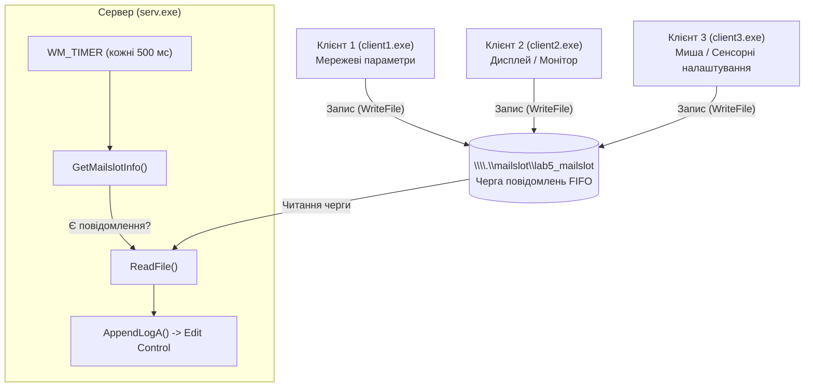

# Пояснення коду сервера (`serv.cpp`)
## Лабораторна робота №5: Клієнт-серверна архітектура з використанням Mailslot (Варіант 9)

---

## 1. Загальний огляд програми

Файл `serv.cpp` реалізує **серверну частину** клієнт-серверної системи на базі операційної системи Windows, що використовує механізм міжпроцесної взаємодії (**IPC — Inter-Process Communication**) під назвою **Mailslot (поштові скриньки)**.

Програма побудована як нативний віконний додаток **Win32 GUI** (без використання консолі), має графічний інтерфейс із меню та багаторядковим полем редагування (`EDIT`), що виконує роль журналу подій (логу).

### Ключові характеристики сервера:
* **Ім'я поштової скриньки:** `\\.\mailslot\lab5_mailslot` (крапка `.` позначає локальний комп'ютер).
* **Тип зв'язку:** Односпрямований (simplex) зв'язок за схемою *"Багато клієнтів — один сервер"* (Many-to-One).
* **Модель опитування:** Періодичне опитування (polling) через таймер WinAPI (`WM_TIMER`, 500 мс) за допомогою `GetMailslotInfo`, що запобігає блокуванню головного GUI-потоку.

---

## 2. Архітектурна схема взаємодії



---

## 3. Глобальні змінні та константи

| Назва / Ідентифікатор | Тип / Значення | Призначення |
| :--- | :--- | :--- |
| `IDT_TIMER` | `1001` | Ідентифікатор системного таймера опитування скриньки |
| `ID_MAILSLOT_CREATE` | `32771` | Команда меню: створити скриньку та запустити сервер |
| `ID_MAILSLOT_CLOSE` | `32772` | Команда меню: закрити скриньку та зупинити сервер |
| `ID_LOG_CLEAR` | `32773` | Команда меню: очистити журнал повідомлень |
| `IDM_ABOUT`, `IDM_EXIT` | `32774`, `32775` | Пункти меню: довідка "Про програму" та вихід |
| `szWindowClass` | `L"MailslotServerClass"` | Ім'я зареєстрованого класу вікна |
| `szTitle` | `L"Server - Mailslot"` | Текст у рядку заголовка вікна |
| `MailslotName` | `L"\\\\.\\mailslot\\lab5_mailslot"` | Системний шлях до поштової скриньки |
| `hwndMain` | `HWND` | Дескриптор головного вікна |
| `hwndEdit` | `HWND` | Дескриптор елемента `EDIT` (поле логу) |
| `hMailslot` | `HANDLE` | Дескриптор відкритої поштової скриньки (`INVALID_HANDLE_VALUE`, якщо закрита) |

---

## 4. Детальний аналіз функцій коду

### 4.1. Точка входу: `wWinMain`
```cpp
int APIENTRY wWinMain(_In_ HINSTANCE hInstance,
    _In_opt_ HINSTANCE hPrevInstance,
    _In_ LPWSTR lpCmdLine,
    _In_ int nCmdShow)
```
1. **Призначення:** Стандартна точка входу для Unicode Win32 GUI-програм.
2. `UNREFERENCED_PARAMETER`: Запобігає попередженням компілятора щодо невикористаних параметрів `hPrevInstance` та `lpCmdLine`.
3. Викликає `MyRegisterClass` для реєстрації класу вікна.
4. Викликає `InitInstance` для створення вікна та головного меню.
5. **Головний цикл повідомлень (Message Loop):**
   ```cpp
   MSG msg;
   while (GetMessage(&msg, nullptr, 0, 0))
   {
       TranslateMessage(&msg);
       DispatchMessage(&msg);
   }
   ```
   Отримує повідомлення з черги потоку, транслює віртуальні клавіші в символьні повідомлення та передає їх у віконну процедуру `WndProc`.

---

### 4.2. Реєстрація віконного класу: `MyRegisterClass`
```cpp
ATOM MyRegisterClass(HINSTANCE hInstance)
```
* Заповнює структуру `WNDCLASSEXW`:
  * `style = CS_HREDRAW | CS_VREDRAW`: Вікно перемальовується при зміні ширини або висоти.
  * `lpfnWndProc = WndProc`: Вказує адресу функції віконної процедури.
  * `hCursor = LoadCursor(nullptr, IDC_ARROW)`: Стандартний курсор-стрілка.
  * `hbrBackground = (HBRUSH)(COLOR_WINDOW + 1)`: Фоновий колір клієнтської області.
* Реєструє клас через функцію `RegisterClassExW(&wcex)`.

---

### 4.3. Створення вікна та меню: `InitInstance`
```cpp
BOOL InitInstance(HINSTANCE hInstance, int nCmdShow)
```
1. **Формування меню:**
   * Створюється горизонтальна панель `hMenuBar` (`CreateMenu`).
   * Створюються два випадаючих підменю (`CreatePopupMenu`):
     * **MailSlot:** *Start Server (Create)*, *Stop Server (Close)*, розділювач, *Clear Log*, розділювач, *Exit*.
     * **Help:** *About...*
2. **Створення вікна:**
   * `CreateWindowW(...)` створює вікно із стилем `WS_OVERLAPPEDWINDOW`.
   * Позиція: `x = 30, y = 30`, розмір: `width = 480, height = 620` (спеціально розміщено зліва екрана, щоб праворуч зручно поміщалися вікна трьох клієнтів).
3. Відображає та оновлює вікно (`ShowWindow`, `UpdateWindow`).

---

### 4.4. Допоміжні функції логування: `AppendLogA` та `AppendLogW`
```cpp
void AppendLogA(HWND hEdit, const char* text);
void AppendLogW(HWND hEdit, const wchar_t* text);
```
Сервер працює з двома типами рядків:
* **`AppendLogA` (ANSI):** Використовується для виведення даних, які надходять від клієнтів (клієнти надсилають стандартний однобайтний текст `char*`). Також автоматично дописує декоративний розділювач:
  ```cpp
  SendMessageA(hEdit, EM_REPLACESEL, FALSE, (LPARAM)"\r\n--------------------------------------------\r\n");
  ```
* **`AppendLogW` (Wide Unicode):** Використовується для внутрішніх системних повідомлень сервера (статус старту, зупинки, створення тощо).

**Механізм дописування в кінець поля `EDIT`:**
1. `GetWindowTextLength(hEdit)` — отримує поточну довжину всього тексту.
2. `SendMessage(..., EM_SETSEL, len, len)` — переносить курсор (виділення) у самий кінець тексту.
3. `SendMessage(..., EM_REPLACESEL, FALSE, text)` — вставляє новий текст у позицію курсора.
4. `SendMessage(..., WM_VSCROLL, SB_BOTTOM, 0)` — автоматично прокручує скролбар донизу, щоб користувач завжди бачив найновіші повідомлення.

---

### 4.5. Віконна процедура: `WndProc`
Головний обробник усіх повідомлень Windows для серверного вікна.

#### А. Обробка `WM_CREATE` (Ініціалізація віджетів)
* Викликається один раз під час створення вікна.
* Створює дочірній елемент керування `EDIT` на всю площу вікна:
  ```cpp
  hwndEdit = CreateWindowW(L"EDIT", ...,
      WS_CHILD | WS_VISIBLE | WS_VSCROLL | ES_LEFT | ES_MULTILINE | ES_AUTOVSCROLL | ES_READONLY,
      10, 10, rc.right - 20, rc.bottom - 20, hWnd, nullptr, hInst, nullptr);
  ```
  * `ES_MULTILINE` — дозволяє відображення багатьох рядків.
  * `ES_READONLY` — захищає журнал від випадкового ручного редагування користувачем.
  * `WS_VSCROLL | ES_AUTOVSCROLL` — вертикальна смуга прокручування.
* Встановлює стандартний системний шрифт `DEFAULT_GUI_FONT` через `WM_SETFONT`.

#### Б. Обробка `WM_SIZE` (Адаптивність інтерфейсу)
* При зміні розмірів головного вікна користувачем викликається `MoveWindow`, який автоматично розтягує або стискає поле `hwndEdit` під нові розміри клієнтської області.

#### В. Обробка `WM_COMMAND` (Пункти меню)
Розбирає ідентифікатор натиснутого пункту меню (`LOWORD(wParam)`):
* **`ID_MAILSLOT_CREATE` (Старт сервера):**
  1. Перевіряє, чи сервер уже не запущений (`hMailslot != INVALID_HANDLE_VALUE`).
  2. Викликає системну функцію WinAPI **`CreateMailslotW`**:
     ```cpp
     hMailslot = CreateMailslotW(MailslotName, 0, MAILSLOT_WAIT_FOREVER, nullptr);
     ```
     * `MailslotName` — ім'я скриньки `\\.\mailslot\lab5_mailslot`.
     * `0` — максимальний розмір повідомлення (`0` означає повідомлення будь-якого допустимого розміру).
     * `MAILSLOT_WAIT_FOREVER` — таймаут очікування операцій читання.
     * `nullptr` — атрибути безпеки за замовчуванням.
  3. Якщо повернуто `INVALID_HANDLE_VALUE`, витягує код помилки через `GetLastError()` та повідомляє про збій.
  4. Якщо успішно: виводить повідомлення про запуск у журнал і запускає періодичний таймер:
     ```cpp
     SetTimer(hWnd, IDT_TIMER, 500, nullptr);
     ```
     Таймер спрацьовуватиме кожні 500 мілісекунд (двічі на секунду).

* **`ID_MAILSLOT_CLOSE` (Зупинка сервера):**
  1. Зупиняє таймер: `KillTimer(hWnd, IDT_TIMER)`.
  2. Закриває системний дескриптор скриньки: `CloseHandle(hMailslot)`.
  3. Скидає стан: `hMailslot = INVALID_HANDLE_VALUE`.
  4. Записує у журнал інформацію про зупинку.

* **`ID_LOG_CLEAR`:** Очищає поле логу через `SetWindowTextW(hwndEdit, ...)`.
* **`IDM_ABOUT`:** Показує діалогове вікно `MessageBoxW` з інформацією про номер лабораторної роботи, тему та варіант 9.
* **`IDM_EXIT`:** Викликає `DestroyWindow(hWnd)`, що ініціює закриття програми.

#### Г. Обробка `WM_TIMER` (Опитування та читання з Mailslot)
Це ключова секція коду, де відбувається прийом даних:
```cpp
case WM_TIMER:
{
    if (wParam == IDT_TIMER && hMailslot != INVALID_HANDLE_VALUE)
    {
        DWORD cbMessage = 0;
        DWORD cMessage = 0;
        DWORD cbRead = 0;

        // Запит стану черги скриньки
        BOOL fResult = GetMailslotInfo(hMailslot, nullptr, &cbMessage, &cMessage, nullptr);
        if (fResult && cMessage != 0 && cMessage != (DWORD)MAILSLOT_NO_MESSAGE)
        {
            // Вичитуємо всі накопичені повідомлення
            while (cMessage > 0)
            {
                char szBuf[4096] = { 0 };
                if (ReadFile(hMailslot, szBuf, sizeof(szBuf) - 1, &cbRead, nullptr) && cbRead > 0)
                {
                    szBuf[cbRead] = '\0';
                    AppendLogA(hwndEdit, szBuf);
                }

                // Перевіряємо, чи є ще повідомлення у черзі
                fResult = GetMailslotInfo(hMailslot, nullptr, &cbMessage, &cMessage, nullptr);
                if (!fResult || cbMessage == MAILSLOT_NO_MESSAGE)
                    break;
            }
        }
    }
    break;
}
```
1. Викликається функція `GetMailslotInfo`:
   * `cbMessage` — розмір наступного повідомлення у байтах. Якщо черга порожня, дорівнює `MAILSLOT_NO_MESSAGE`.
   * `cMessage` — загальна кількість повідомлень у черзі скриньки.
2. Якщо `cMessage > 0`:
   * Сервер у циклі `while` вичитує кожне повідомлення стандартною функцією WinAPI **`ReadFile`**.
   * Буфер розміром 4096 байт очищається нулями (`{ 0 }`).
   * Після читання встановлюється термінальний нуль `szBuf[cbRead] = '\0'` для безпечної роботи з рядком.
   * Текст передається у функцію `AppendLogA(hwndEdit, szBuf)` і з'являється на екрані.
   * Стан черги повторно запитується через `GetMailslotInfo`.

#### Д. Обробка `WM_DESTROY` (Коректне очищення ресурсів)
При закритті вікна:
1. Якщо сервер ще був активний (`hMailslot != INVALID_HANDLE_VALUE`):
   * Скасовується таймер: `KillTimer(hWnd, IDT_TIMER)`.
   * Закривається дескриптор ядра Windows: `CloseHandle(hMailslot)`.
2. Викликається `PostQuitMessage(0)`, що надсилає повідомлення `WM_QUIT` у чергу потоку і коректно завершує цикл `GetMessage`.

---

## 5. Специфіка використання Mailslot у даній роботі

### Чому обрано підхід з `WM_TIMER`, а не блокуюче читання в окремому потоці?
* У Windows функція `ReadFile` для Mailslot із параметром `MAILSLOT_WAIT_FOREVER` зупиняє (блокує) потік доти, доки не надійде повідомлення.
* Якщо викликати таку блокуючу операцію безпосередньо у віконному потоці, графічний інтерфейс програми зависне (стане "Not Responding"), не реагуючи на натискання кнопок, переміщення чи закриття.
* Опитування через `WM_TIMER` у комбінації з `GetMailslotInfo`:
  * Перевіряє наявність даних не блокуючи потік.
  * Викликає `ReadFile` лише тоді, коли дані **вже гарантовано є в буфері**.
  * Забезпечує високу плавність GUI і легкість коду без потреби в складній синхронізації м'ютексів та додаткових потоків (`CreateThread`).

### Особливості механізму Mailslot:
1. **Односторонність:** Mailslot призначений тільки для односторонньої передачі (клієнти можуть лише писати, а створити й читати скриньку може лише процес-сервер).
2. **Черга FIFO:** Повідомлення зберігаються за принципом *"перший прийшов — перший пішов"*.
3. **Мережева прозорість:** Формат імені `\\.\mailslot\...` використовується локально, проте замість `.` можна вказати ім'я віддаленого комп'ютера або домену (`\\computername\mailslot\...` або `\\*\mailslot\...` для широкомовлення).

---

## 6. Типові запитання для захисту лабораторної роботи

1. **Що повертає `CreateMailslot` у разі помилки?**
   * Повертає значення `INVALID_HANDLE_VALUE` (а не `NULL`). Код конкретної системної помилки отримується через `GetLastError()`.
2. **Чим Mailslot відрізняється від Named Pipes (іменованих каналів)?**
   * Mailslot є односпрямованим (simplex), тоді як Named Pipes зазвичай двоспрямовані (duplex).
   * Mailslot підтримує широкомовні повідомлення (broadcast) до багатьох комп'ютерів у мережі через датаграми, тоді як Named Pipes забезпечують надійне з'єднання "точка-точка" з гарантією доставки за протоколом на базі з'єднань.
3. **Яка функція відповідає за перевірку кількості повідомлень у скриньці?**
   * Функція `GetMailslotInfo`.
4. **Як клієнти надсилають повідомлення в цей Mailslot?**
   * Клієнти використовують стандартну функцію `CreateFileW` з прапорцем `GENERIC_WRITE` та `OPEN_EXISTING`, після чого записують байти через функцію `WriteFile` і закривають дескриптор через `CloseHandle`.
